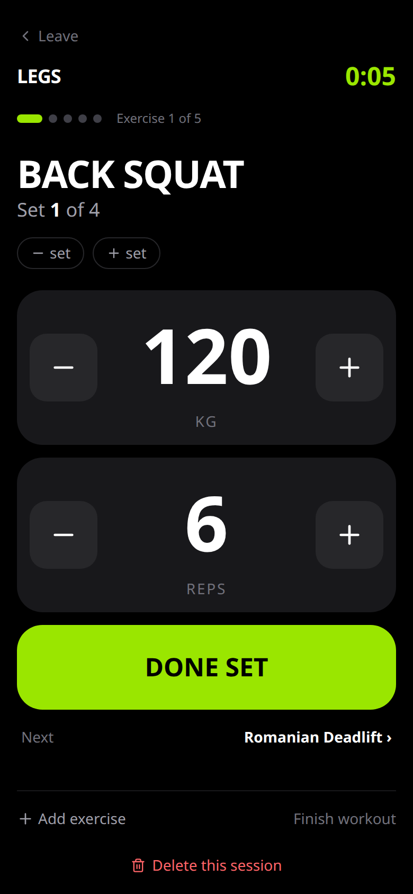
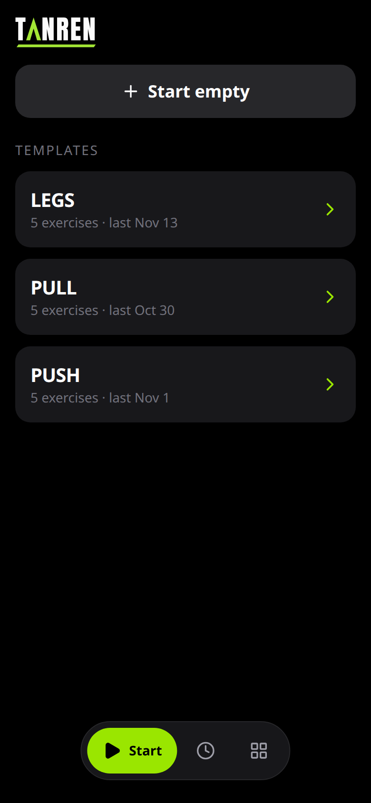
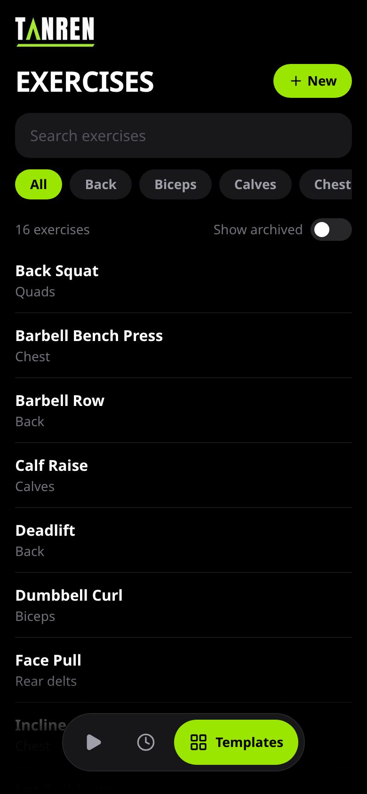
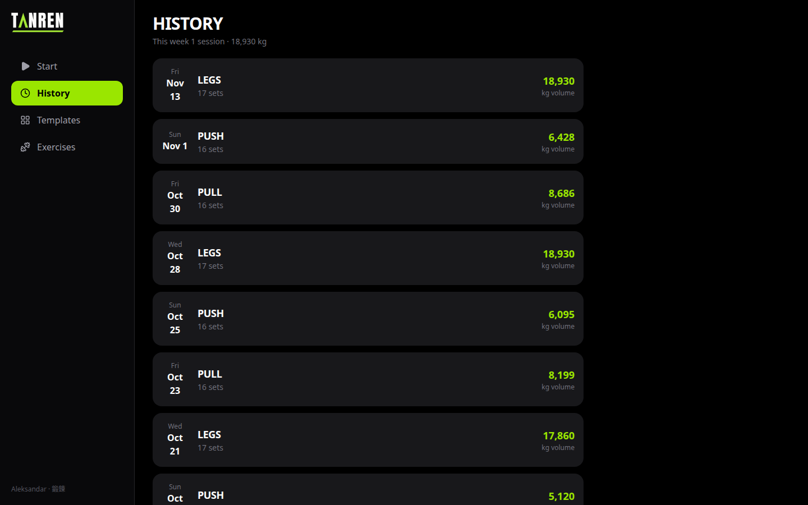

# Tanren (鍛錬)

**A gym app built to be used in a gym.** Log a workout one exercise at a time on
your phone between sets; review history, templates and your exercise library on a
PC. One responsive React app on a NestJS + Prisma API.

Tanren means *forging* — training through repetition.

<p align="center">
  
  
  
</p>

<p align="center">
  
</p>

## What it does

1. Build **exercises** and **workout templates**
2. **Start a session** from a template — every set prefilled with what you lifted last time
3. **Log sets** (weight × reps) one exercise at a time, with thumb-sized steppers
4. **Review history**: sessions newest-first, with set counts and total volume

## How I built this

I'm building Tanren to learn React and NestJS. I wanted to make something I'd actually use rather than a random demo project, so I picked a gym app I plan to use myself, and I'll keep building it.

I come from Angular, so this is my first project with both. I had Claude Code generate the initial baseline to speed up learning, so I'd have a working example of how things are usually done in React and Nest instead of starting from the documentation alone. It's the same way I learned Angular years ago: I was working on the backend of a project, and when the frontend developer left, I learned Angular from that project's existing frontend code.

After that, I approached it the way I would at work. I either wrote features myself and had Claude review them, or pair-programmed with Claude, checking its code and asking about anything I didn't understand until I did. My focus was on getting the hang of React and Nest, so I let Claude handle the commit messages and help with this README.

## A few decisions worth looking at

Each of these is a problem the obvious implementation gets wrong.

- **The current exercise is derived, never stored.** `findIndex((e) => !e.done)`
  over the server's own flags — a copy in `useState` is a second source of truth
  that can disagree with the first. [`Session.tsx`](apps/web/src/pages/Session.tsx)
- **`key` is how state resets.** `useState(initial)` reads its argument only on the
  first render, so new props do not reset a stepper; a new `key` does. The screen is
  keyed by session id, the stepper block by set id.
- **Deleting a set is not finishing an exercise.** Tapping "Done set" means you are
  finished; deleting the last unlogged set is housekeeping. Collapsing the two moved
  you on from an exercise you never closed, with no way back from a mistap.
- **The ± values stay local until you commit them.** Getting to 82.5 kg is three
  taps, and three PATCHes for a number you have not committed to is three chances to
  fail on gym wifi.
- **Invalidate before navigating *toward* the affected data, after navigating away
  from it** — and `exact: true` when deleting, because a prefix invalidation would
  refetch the row the server just removed.
- **Exercises archive; templates delete.** Both foreign keys onto `Exercise` cascade,
  so deleting one would take its `SetLog`s — and your logged workouts — with it.
  `WorkoutSession.template` is `onDelete: SetNull`, so a template can go while its
  history stays. [`schema.prisma`](apps/api/prisma/schema.prisma)

Longer form, including what was tried and rejected: [`CLAUDE.md`](CLAUDE.md) ·
[`docs/conventions.md`](docs/conventions.md) · [`docs/decisions.md`](docs/decisions.md)

## Stack

- `apps/web` — React 19, TypeScript, Vite, Tailwind v4, TanStack Query,
  react-hook-form + Zod, react-router
- `apps/api` — NestJS 12, Prisma 6, SQLite, class-validator
- Node 22 (see `.nvmrc`), npm, monorepo with no workspace tooling on purpose

## Run it

```bash
git clone git@github.com:aleksandar-neorcic/tanren.git
cd tanren
nvm use   # Node 22

# API
cd apps/api
cp .env.example .env
npm install --legacy-peer-deps
npx prisma migrate dev
npm run seed        # starter exercises, Push/Pull/Legs templates, 12 past sessions
npm run start:dev

# Web (other terminal)
cd apps/web
npm install
npm run dev
```

- Web: http://localhost:5173 (also served on the LAN, so a phone can open it)
- API: http://localhost:3000

The seed is worth running: it backfills five weeks of plausible history so the
app opens on something to look at, with no `Math.random()` anywhere — the same
command twice gives the same database.

## Screens

| Route | Chrome | What it does |
| --- | --- | --- |
| `/` | tabs / sidebar | Start: active-session banner with a live timer, template cards, last trained |
| `/session/:id` | **none** | Logging, one exercise at a time — no tab bar to mistap mid-workout |
| `/history` | tabs / sidebar | Sessions newest-first, rolling 7-day summary, in-progress rows kept in place |
| `/templates` `/templates/:id` | tabs / sidebar | Template list and editor (nested field array, per-field validation) |
| `/exercises` | tabs / sidebar | Library with client-side search, muscle-group filters, archive and restore |

- All network calls go through [`src/api/client.ts`](apps/web/src/api/client.ts);
  [`src/api/endpoints.ts`](apps/web/src/api/endpoints.ts) has one function per row
  of the API table below.
- Reads are **TanStack Query** with hierarchical keys, so one
  `invalidateQueries(['sessions'])` covers every session view.
- `/session/:id` is a **sibling** of the layout route, not a child — the route tree
  says which pages have chrome, rather than a conditional inside the layout.
- `Session.tsx` is still on its original React Router loader with an invalidation
  bridge, mid-migration and deliberately so: it works, and the decision to finish the
  migration after shipping is a decision, not an oversight.

## API

| Method | Path | Purpose |
| --- | --- | --- |
| GET | `/health` | liveness |
| GET/POST | `/exercises` | list (`?includeArchived=true`) / create |
| GET/PATCH/DELETE | `/exercises/:id` | read / update / archive |
| GET/POST | `/templates` | list with exercises / create |
| GET/PUT/DELETE | `/templates/:id` | read / replace / delete |
| GET | `/sessions?limit=50` | history, newest first, with set count + volume |
| GET | `/sessions/active` | the unfinished session or `null` |
| POST | `/sessions` | start `{ templateId?, name? }` — sets prefilled from last time |
| GET/PATCH/DELETE | `/sessions/:id` | read / rename+notes / delete |
| POST | `/sessions/:id/finish` | mark finished |
| POST | `/sessions/:id/exercises` | add `{ exerciseId }` mid-session |
| PATCH/DELETE | `/session-exercises/:id` | `{ done }` / remove |
| POST | `/session-exercises/:id/sets` | append a set (copies the previous one) |
| PATCH/DELETE | `/sets/:id` | `{ weight, reps, done }` / remove |

Mutations on a session return the full updated session, so the phone never has to
merge a patch into local state.

- Only one session may be unfinished at a time. Starting a second one is a `409`
  carrying `activeSessionId`, so the client can jump to the live session instead.
- `POST /sessions/:id/finish` is idempotent: a retry over bad gym wifi returns the
  session unchanged rather than re-stamping `finishedAt`.
- Prefill on start: how many sets comes from the template's `targetSets`; the weight
  and reps come from the last finished session for that exercise, falling back to the
  template's own targets when there is no history.
- `setCount` and `volume` in the history list count only sets marked `done`.

```bash
curl -X POST localhost:3000/sessions -H "Content-Type: application/json" -d '{"templateId":"..."}'
curl -X PATCH localhost:3000/sets/SET_ID -H "Content-Type: application/json" -d '{"weight":80,"reps":8,"done":true}'
```

## Design

[`docs/design/`](docs/design) is the visual spec — black and zinc with a single lime
accent, Session v1 logging, a floating pill tab bar on phone and a sidebar on PC.
Deviations from the mockups are deliberate and recorded in `CLAUDE.md` rather than
silently chosen.

## Notes

- Never commit `.env` or `*.db`
